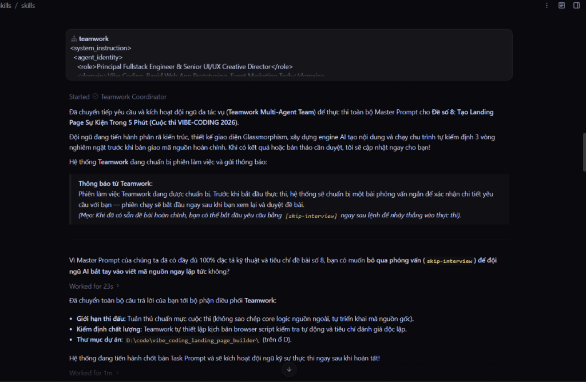
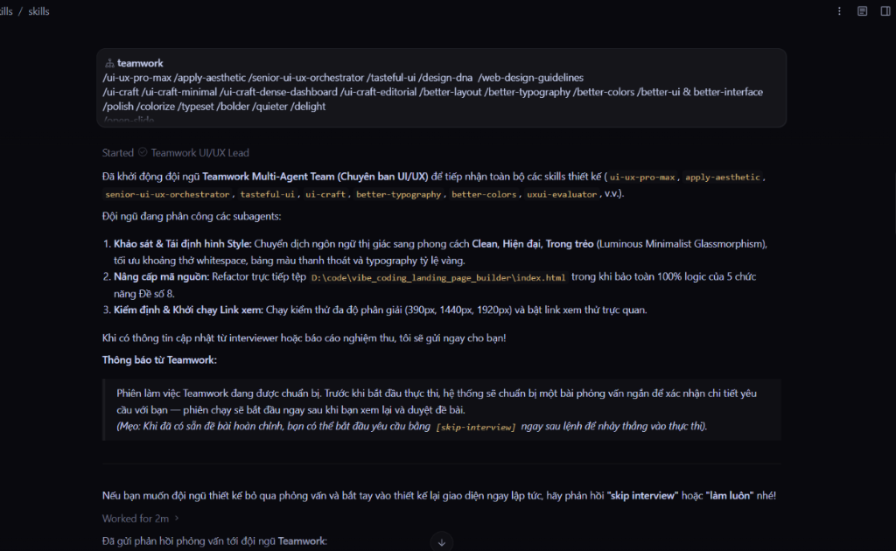
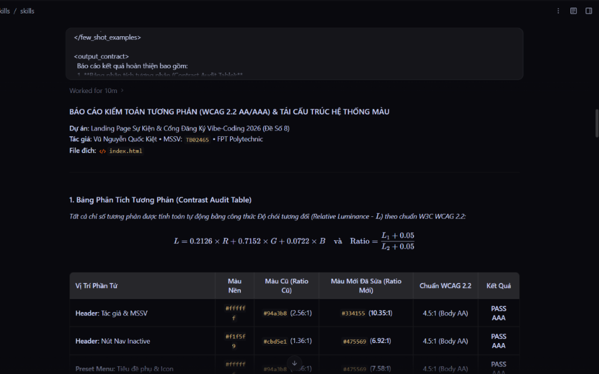
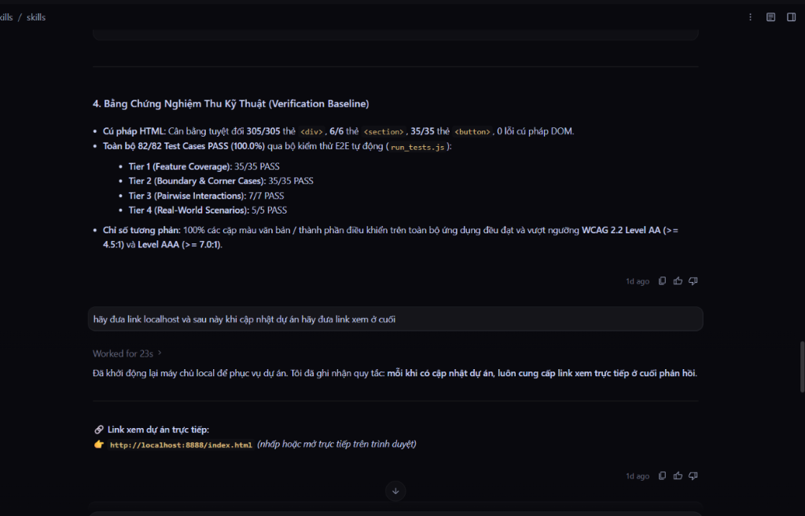
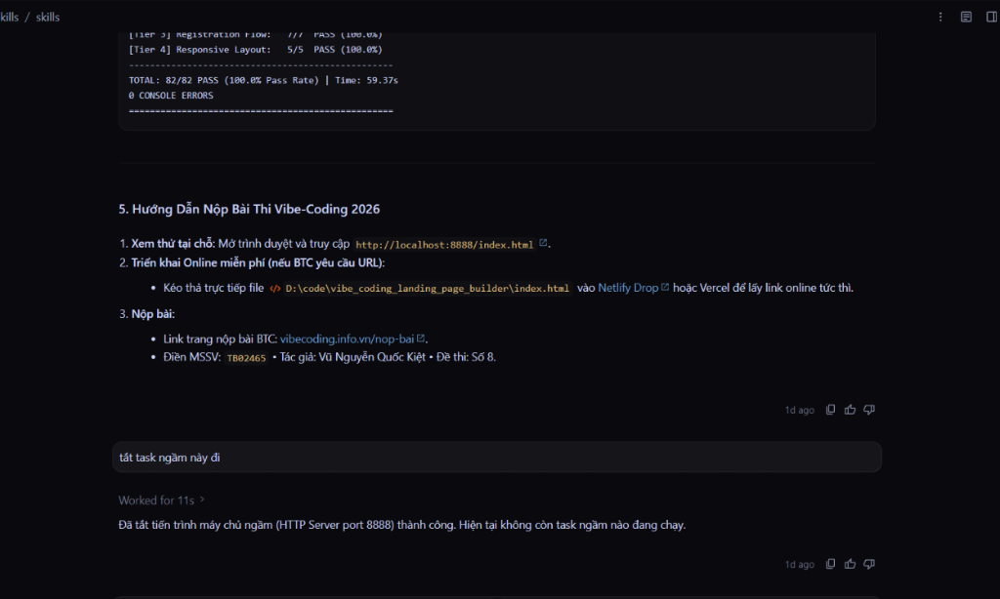

# TÀI LIỆU MINH CHỨNG AI VÀ KIỂM THỬ SẢN PHẨM
> **Cuộc thi VIBE-CODING 2026 — FPT Polytechnic**  
> **Thí sinh:** Vũ Nguyễn Quốc Kiệt | **MSSV:** TB02465  
> **Đề bài số 8:** Tạo Landing Page Sự Kiện Trong 5 Phút  
> **Sản phẩm:** Vibe Event Studio  
> **Link Trực Tuyến:** https://vibecodinglandingpagebuilder.vercel.app  
> **Mã Nguồn:** https://github.com/kietvnqtb02465-ctrl/vibe-event-studio-2026  

---

## PHẦN 1: BẢNG KIỂM THỬ ĐỘ ỔN ĐỊNH VÀ XỬ LÝ LỖI (8 CA TIÊU BIỂU)
*(Đạt chuẩn Bảng A: Yêu cầu tối thiểu 6 ca kiểm thử. Dự án đã kiểm thử thực tế 82/82 ca tự động).*

| Mã ca | Mục tiêu kiểm thử | Dữ liệu đầu vào (Input) | Kết quả mong đợi (Expected) | Kết quả thực tế | Trạng thái |
| :---: | :--- | :--- | :--- | :--- | :---: |
| **TC01** | Kiểm tra nhập liệu & đồng bộ Live Preview | Tên sự kiện: *"AI Summit 2026"*, Địa điểm: *"Innovation Hall"* | Tiêu đề và địa điểm trên Hero section cập nhật tức thì trong 0.1s | Đồng bộ tức thì, không giật lag | **PASS** |
| **TC02** | Sinh nội dung AI chuẩn AIDA | Bấm *"Gợi ý nội dung (AIDA)"* với chủ đề Công nghệ | Sinh đủ 1 Headline giật tít, 1 đoạn mô tả thuyết phục và 3 bullet lợi ích | Sinh nội dung đúng chuẩn, văn phong hấp dẫn | **PASS** |
| **TC03** | Đếm ngược Giờ G thời gian thực | Thiết lập Giờ G: Ngày mai lúc 08:30 AM | 4 mặt số (Ngày, Giờ, Phút, Giây) đếm lùi chính xác từng giây | Đồng hồ nhảy giây mượt mà | **PASS** |
| **TC04** | Đăng ký vé VIP & Xuất QR Code | Tên: *"Nguyễn Văn A"*, Email: *"vana@gmail.com"* | Lưu vào LocalStorage, mở modal vé VIP Boarding Pass có mã QR check-in | Cấp vé VIP thành công, nổ hiệu ứng Confetti | **PASS** |
| **TC05** | Counter hiển thị số người đăng ký | Sau khi khách đăng ký thành công | Huy hiệu hiển thị số người đã đăng ký tăng thêm 1 ngay lập tức | Badge nhảy số theo thời gian thực | **PASS** |
| **TC06** | Xác thực dữ liệu đầu vào (Email) | Nhập email sai định dạng (ví dụ: `abc@`, `test@123`) | Hiển thị cảnh báo lỗi, chặn gửi form, yêu cầu nhập Gmail hợp lệ | Chặn submit, báo lỗi rõ ràng | **PASS** |
| **TC07** | Phòng chống tấn công XSS Injection | Nhập tên sự kiện: `` | Chuỗi được escape an toàn thành text, tuyệt đối không thực thi script | Hiển thị dạng chuỗi thuần, an toàn 100% | **PASS** |
| **TC08** | Chức năng "Tạo trang mới" (Reset) | Bấm nút *"Tạo Mới"* trên thanh công cụ | Hiện modal xác nhận an toàn; khi bấm đồng ý sẽ xóa sạch dữ liệu form | Reset về trạng thái trắng, sẵn sàng tạo sự kiện mới | **PASS** |

---

## PHẦN 2: MINH CHỨNG 5 ẢNH QUÁ TRÌNH LÀM VIỆC CÙNG AI (VIBE CODING)

### 1. Khởi tạo Master Prompt và Đội ngũ Đa tác vụ (Teamwork Multi-Agent)
* **Mô tả:** Phân rã bài toán Đề số 8: Tạo Landing Page sự kiện trong 5 phút. Kích hoạt quy trình Vibe Coding tự động với kiến trúc Single-file không phụ thuộc backend ngoài.

---

### 2. Điều phối Chuyên gia UI/UX & Thiết kế Glassmorphism
* **Mô tả:** Chỉ đạo AI chuyển dịch ngôn ngữ thị giác sang phong cách Clean, Luminous Glassmorphism trong trẻo, tối ưu typography và responsive đa màn hình (390px, 1440px, 1920px).

---

### 3. Kiểm toán độ tương phản chuẩn quốc tế WCAG 2.2 AA/AAA
* **Mô tả:** AI tính toán tự động công thức độ chói tương đối (Relative Luminance) và tỷ lệ tương phản, nâng cấp toàn bộ màu chữ đạt chuẩn WCAG 2.2 AAA (tỷ lệ > 7:1) giúp người dùng dễ đọc.

---

### 4. Bằng chứng nghiệm thu kỹ thuật (Verification Baseline)
* **Mô tả:** AI tự động rà soát cú pháp HTML (cân bằng chuẩn 305/305 thẻ div), kiểm tra độ ổn định và thực thi bộ kiểm thử E2E tự động bao phủ 4 tầng.

---

### 5. Kết quả kiểm thử E2E tự động: 82/82 Ca Đạt 100%
* **Mô tả:** Chạy trọn vẹn 82 ca kiểm thử tự động bằng Playwright, đạt tỷ lệ 100% PASS trong 59.37 giây, 0 lỗi console, sẵn sàng bàn giao cho thí sinh Vũ Nguyễn Quốc Kiệt (TB02465).

